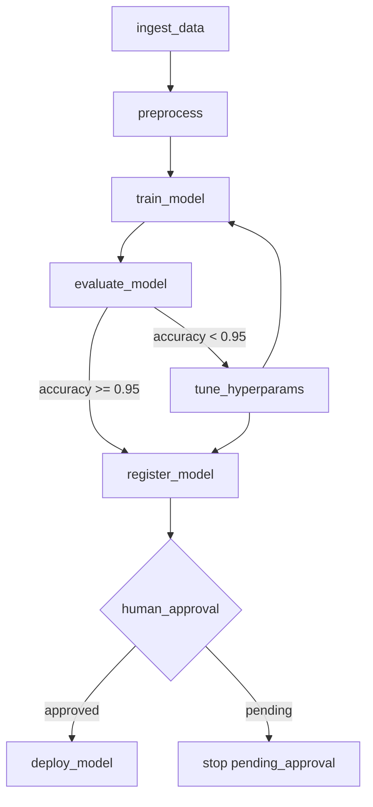

# ML Pipeline DAG - Week 9

## Ray pipeline flow



## Stages

| Stage | Ray task | Script |
|-------|----------|--------|
| Ingest | `ingest_data` | `scripts/bootstrap.py` |
| Preprocess | `preprocess` | `src/prepare_data.py` |
| Train | `train_model` | `src/train.py` |
| Evaluate | `evaluate_model` | `src/evaluate.py` |
| Tune (conditional) | `tune_hyperparams` | params override |
| Register | `register_model` | `scripts/register_model.py` |
| Approve (HITL) | `check_human_approval` | `approvals/production.flag` |
| Deploy | `deploy_model` | GitOps hook (week 6) |

## Run

```bash
ray start --head
python pipeline/ray_pipeline.py --run-id exp-001
touch approvals/production.flag
python pipeline/ray_pipeline.py --run-id exp-001 --approve
```