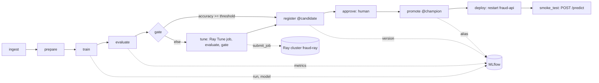
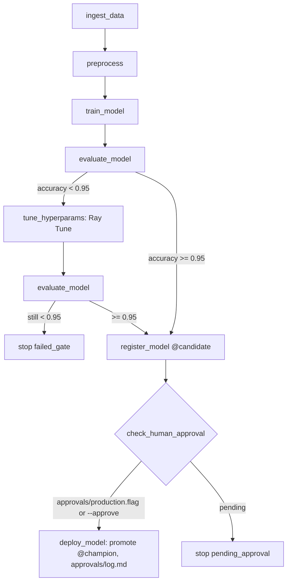

# ML Pipeline DAG - Week 9

## `fraud_pipeline` (Airflow 3, `pipeline/dags/fraud_dag.py`)



| Task | Kind | Runs | Script / operator |
|------|------|------|-------------------|
| ingest | pod (`fraud-train:lab9`) | `src/ingest.py` | synthetic "today's data", md5 logged |
| prepare | pod | `src/prepare_data.py` | week-2 script, unchanged |
| train | pod | `src/train.py --max_depth {{ params.max_depth }} --n_estimators {{ params.n_estimators }}` | MLflow run + logged model |
| evaluate | pod + XCom | `src/evaluate.py` -> `/airflow/xcom/return.json` | `metrics.json` back to Airflow (a few bytes) |
| gate | `@task.branch` | compares `accuracy` with `params.threshold` | returns `register` or `tune` |
| tune | pod, `retries=0` | `pipeline/ray_jobs/submit_job.py` -> `pipeline/ray_jobs/tune_fraud.py` on the Ray cluster; then `evaluate.py` and `scripts/check_model_gate.py` | deterministic failure when still below threshold |
| register | pod, `trigger_rule=none_failed_min_one_success` | `scripts/promote_model.py register --alias candidate --tag airflow_run_id=...` | idempotent |
| approve | `ApprovalOperator` | waits under *Required Actions* | user + time recorded |
| promote | pod | `scripts/promote_model.py promote --to champion` | the alias move is the deployment |
| deploy | `@task` (Kubernetes API) | rollout restart of `mlops/fraud-api`, waits for readiness | Role `fraud-deployer` |
| smoke_test | pod + XCom | `scripts/smoke_test_api.py --url http://fraud-api.mlops.svc/predict` | one prediction |

Parameters (Trigger DAG w/ config): `threshold` 0.95, `max_depth` 5, `n_estimators` 100.
Lab runs: **A** defaults (direct path), **B** `{"max_depth": 1}` (weak model -> tune on Ray -> rescued),
**C** `{"threshold": 0.999}` (unreachable -> `tune` fails at the gate -> red run, nothing registered).

## `pipeline/ray_pipeline.py` (Ray only, called by week 10)



```bash
export MLFLOW_TRACKING_URI=http://localhost:5001
python pipeline/ray_pipeline.py --run-id exp-001          # -> pending_approval, metrics.json at the root
touch approvals/production.flag
python pipeline/ray_pipeline.py --run-id exp-001 --approve
```
